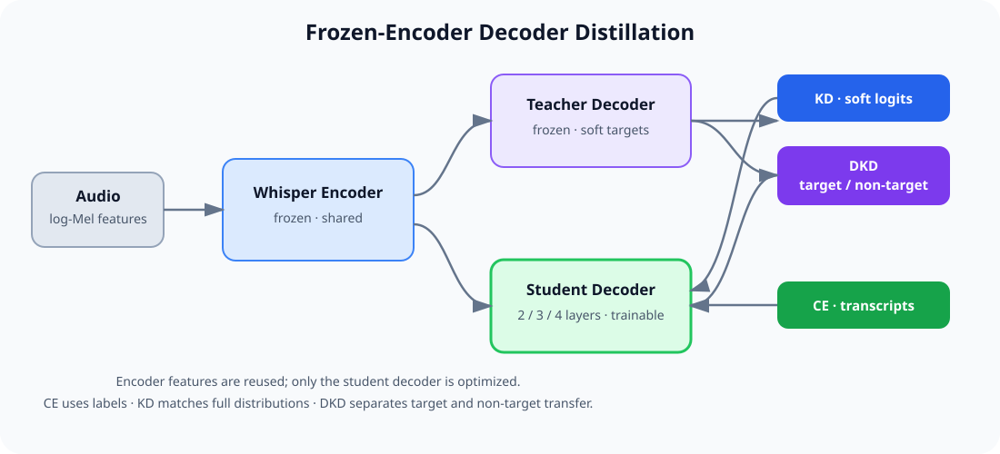
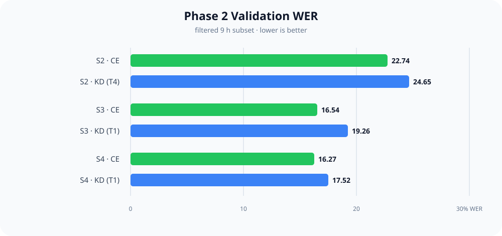

# Whisper Decoder Knowledge Distillation

A compact research implementation for compressing Whisper by keeping its pretrained encoder frozen and training smaller 2/3/4-layer decoders with cross-entropy (CE), knowledge distillation (KD), or decoupled knowledge distillation (DKD).

## Project status


| Area                    | Status        | Notes                                                                             |
| ----------------------- | ------------- | --------------------------------------------------------------------------------- |
| CE / KD / DKD training  | ✅ Implemented | Unified YAML configuration and device selection                                   |
| Frozen-encoder students | ✅ Implemented | Whisper tiny, small, and large teachers supported                                 |
| Experiment artifacts    | ✅ Indexed     | Tracked summaries live in `analysis/`; checkpoints and logs are generated locally |
                                                                               


## Architecture



The teacher is frozen. Its encoder representation is shared with the student decoder, and only the student decoder receives gradient updates. CE learns from transcripts, KD matches the teacher's softened token distribution, and DKD separates target-class and non-target-class transfer.

## Repository layout

```text
workspace-whisper/
├── assets/                 # README architecture and result figures
├── configs/                # CE, KD, DKD, and ablation YAML files
├── src/
│   ├── data/               # LibriSpeech dataset, collation, deterministic splits
│   ├── models/             # Frozen teacher and student decoder models
│   ├── training/           # CE, KD, and DKD entry points
│   └── utils/              # Configuration, logging, and ASR metrics
├── scripts/                # Training, evaluation, and analysis helpers
├── analysis/               # Tracked run inventory, parameter counts, and FLOPs
├── doc/                    # Historical plans and experiment notes
├── test_setup.py           # Phase 1 setup check
├── test_phase2_setup.py    # File, config, and dependency check
└── requirements.txt
```

`outputs/`, `logs/`, downloaded datasets, and model checkpoints are intentionally ignored because they are large generated artifacts. The source package `src/data/` is tracked.

## Setup

The reference environment uses Python 3.11. A CUDA GPU with at least 16 GB VRAM is recommended.

```bash
git clone https://github.com/Emmastyle/Whisper-Distillation.git
cd Whisper-Distillation
conda create -n whisper python=3.11 -y
conda activate whisper
python -m pip install -r requirements.txt
python test_phase2_setup.py
```

The Hugging Face dataset and teacher weights are downloaded on first use. `requirements.txt` contains the direct runtime, evaluation, plotting, and FLOP-analysis dependencies used by this repository.

## Data and reproducibility

The default Phase 2 setup loads LibriSpeech `train-clean-100`, keeps clips up to 10 seconds, and historically retained 5,366 clips (~9.17 hours). To match the original experiments, the loader deterministically assigns at most 100 samples to validation and uses the remainder for training. With 5,366 filtered clips this produces the historical `5,266 / 100` split. No independent test partition is created.

## Training

All Python training entry points accept `--device`. It defaults to `auto`; examples include `--device cpu`, `--device cuda`, and `--device cuda:1`. No script pins a personal GPU number.

```bash
# CE baseline
python -m src.training.train_ce \
  --config configs/small_ce_s3.yaml \
  --device auto

# Classical KD
python -m src.training.train_kd \
  --config configs/small_kd_s3_t1_a01.yaml \
  --device auto

# Decoupled KD
python -m src.training.train_dkd \
  --config configs/small_dkd_s3_t1_a20.yaml \
  --device auto
```

Portable shell wrappers accept a config as their first argument and forward remaining options:

```bash
bash scripts/train_ce.sh configs/small_ce_s2.yaml --device cuda
bash scripts/train_kd.sh configs/small_kd_s2.yaml --device cuda
```

For the three-job large CE launcher, devices must be selected explicitly:

```bash
GPU_IDS=0,1,2 bash scripts/train_large_ce_parallel.sh
```


## Quick Start

All training entry points accept `--device` (`auto`, `cpu`, `cuda`, or `cuda:N`). The default is `auto`.

### Phase 1 (tiny, minimal subset)

```bash
python -m src.training.train_ce --config configs/ce_tiny_s2.yaml
python -m src.training.train_kd --config configs/kd_tiny_s2.yaml
```


### Phase 2 (small, ~9 h subset)

```bash
# Data profiling (already generated once; re-run if you change filters)
python scripts/analyze_data_100h.py

# CE baselines
bash scripts/train_ce.sh configs/small_ce_s2.yaml
bash scripts/train_ce.sh configs/small_ce_s3.yaml
bash scripts/train_ce.sh configs/small_ce_s4.yaml

# KD baselines (T=4, α=0.5 by default)
bash scripts/train_kd.sh configs/small_kd_s2.yaml
bash scripts/train_kd.sh configs/small_kd_s3.yaml
bash scripts/train_kd.sh configs/small_kd_s4.yaml

# Temperature sweep for S3 (T=2/3/4/5/6/8)
bash scripts/train_temperature_sweep.sh

# Unified evaluation (WER/CER, params, FLOPs, speed)
python scripts/evaluate_all_models.py --num_samples 100
```

Artifacts go to `outputs/` (checkpoints/logs) and `results/` (tables/plots).

## Key Results (Phase 2, filtered 9 h set)

Best runs from `analysis/runs_table.md`:


| Model | Loss    | T   | WER (%) | CER (%) | Notes                               |
| ----- | ------- | --- | ------- | ------- | ----------------------------------- |
| S4 CE | CE-only | –   | 16.27   | 6.90    | Best overall on subset              |
| S3 CE | CE-only | –   | 16.54   | 7.36    | Very close to S4 with fewer layers  |
| S2 CE | CE-only | –   | 22.74   | 11.66   | Smallest student, still reasonable  |
| S4 KD | KD      | 1.0 | 17.52   | 11.08   | KD underperformed CE on this subset |
| S3 KD | KD      | 1.0 | 19.26   | 9.79    | KD slightly worse than CE           |
| S2 KD | KD      | 4.0 | 24.65   | 12.30   | KD did not beat CE                  |




Takeaways:

- On the 9 h filtered set, CE baselines outperform KD; KD likely needs more data or retuned α/T.
- Training/validation followed the provided configs; CUDA OOM cases were resolved by restarting with the final configs logged above.
- Teacher baseline metrics were not logged in the repo; re-run `python scripts/test_teacher_small.py --num_samples 100` if you need them.

